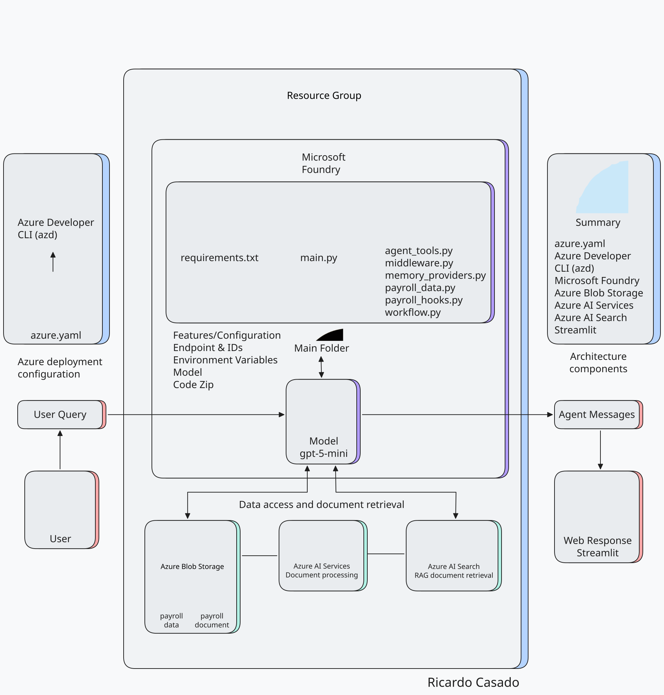

# Payroll AI Agent

An AI Agent built with Azure AI Foundry, Agent Framework, Azure AI Search, Azure Blob Storage, and Streamlit. The agent can calculate payroll statistics, perform data-quality checks, identify records that require review, compare payroll periods, and retrieve relevant regulatory information. Its queries use two types of datasets. The first consists of structured CSV payroll data from the City of Houston:
https://data.houstontx.gov/dataset/payroll

The second consists of unstructured documents covering payroll regulations applicable to City of Houston employees, including specific provisions for certain groups, such as firefighters and police officers.

An AI Agent built with Azure AI Foundry, Agent Framework, Azure AI Search, Azure Blob Storage, and Streamlit. The agent can calculate payroll statistics, perform data-quality checks, identify records that require review, compare payroll periods, and retrieve relevant regulatory information. Its queries use two types of datasets. The first consists of structured CSV payroll data from the City of Houston:
https://data.houstontx.gov/dataset/payroll

The second consists of unstructured documents covering payroll regulations applicable to City of Houston employees, including specific provisions for certain groups, such as firefighters and police officers.

## Features

- 🤖 **AI-powered chat interface**: Interact with the payroll agent through a Streamlit conversational interface.
- 📊 **Structured payroll analysis**: Calculate salary statistics and perform data-quality checks on payroll CSV files stored in Azure Blob Storage.
- 🔎 **Regulatory document retrieval**: Retrieve relevant payroll regulations and employment guidance using Azure AI Search and RAG.
- 🧰 **Automatic tool selection**: Allow the agent to select the appropriate calculation, validation, workflow or search tool for each request.
- 💾 **Persistent chat history**: Preserve Streamlit conversations locally across application reruns.
- ☁️ **Microsoft Foundry hosting**: Deploy the containerized agent through Azure Developer CLI and expose it using the Responses Protocol.

## Architecture

The following diagram summarizes the project architecture, including the Microsoft Foundry hosted agent, the GPT-5 mini model deployment, Azure Blob Storage, document processing, Azure AI Search and the Streamlit interface.

## Demo

The following video demonstrates the Streamlit interface communicating with the payroll agent hosted in Microsoft Foundry. It shows structured payroll analysis, conversational context and regulatory-document retrieval through Azure AI Search.

[Watch the Payroll AI Agent demo](docs/demo/Payroll-Agent-Demonstration.mp4)

## Runtime and container

The hosted agent runs in a Python 3.13 container. Its Python
dependencies are declared in
[`requirements.txt`](src/payroll-agent-ai-search/requirements.txt),
including Microsoft Agent Framework, Microsoft Foundry integration,
Azure authentication, Azure Blob Storage access, and pandas.

The
[`Dockerfile`](src/payroll-agent-ai-search/Dockerfile) installs these
dependencies, copies the agent source, exposes port `8088`, and starts
the Responses Protocol server through `main.py`.

The Python version is aligned across local development, `azure.yaml`,
and the container configuration.

## Azure deployment configuration 

The project uses [`azure.yaml`](azure.yaml) to configure and deploy the Microsoft Foundry hosted agent. This file defines the Python entry point, runtime resources, environment variables, Microsoft Foundry project, Azure AI Search connection, Foundry Toolbox and Responses protocol.

The configuration references existing Azure resources, including the `payroll-rag` search index and the Blob Storage container containing the payroll CSV files as well as legal documents.

For a detailed explanation of the services, environment variables, managed identities and deployment configuration, see [Azure configuration](docs/azure-configuration.md).

## Agent architecture
### Agent tools and capabilities 
El proyecto utiliza  `agent_tools.py` para configurar las tools. Estas son elegidas por el AI Agent en base a si la consulta dada las requiere, por lo que son opcionales. Its available tools support payroll calculations, validation, period comparison, and regulatory document retrieval and they are registered with the agent in [`main.py`](src/payroll-agent-ai-search/main.py).

| Capability | Purpose | Defined in |
|---|---|---|
| `get_salary_statistics` | Calculates Annual Base Salary statistics for a payroll year and Pay Grade | `agent_tools.py` |
| `validate_payroll_values` | Finds missing and negative values in a selected payroll column | `agent_tools.py` |
| `validate_payroll_data` | Performs general payroll data-quality checks | `agent_tools.py` |
| `find_exempt_employees_with_overtime` | Identifies exempt payroll records containing positive Overtime Pay | `agent_tools.py` |
| `run_payroll_comparison_workflow` | Validates and compares the configured 2025 and 2026 payroll datasets | `workflow.py` |
| `payroll_search` | Retrieves payroll regulations and supporting documents through Azure AI Search | `azure.yaml` and Foundry Toolbox |

For parameters, returned results, limitations, and example requests,
see [Agent tools and capabilities](docs/tools_explained.md).

### Payroll data access and caching 
[`payroll_data.py`](src/payroll-agent-ai-search/payroll_data.py)
centralizes access to the payroll CSV files stored in Azure Blob
Storage. It validates the requested payroll year, resolves the
corresponding blob name, authenticates with Azure, downloads the CSV,
converts it into a pandas DataFrame, and caches the result to avoid
repeated downloads.

### Middleware and execution logging  
[`middleware.py`](src/payroll-agent-ai-search/middleware.py) defines
middleware for observing agent and tool executions.

The agent middleware records when an agent execution starts and
finishes. The tool middleware records the same events for every tool
invocation and includes the name of the selected tool.

The middleware records only technical execution events. It does not
log user messages, tool parameters, payroll records, or tool results.
Both middleware functions are registered with the agent in
[`main.py`](src/payroll-agent-ai-search/main.py).

For further details, see
[Middleware and execution logging](docs/middleware-explained.md).

### Conversation context 

[`memory_providers.py`](src/payroll-agent-ai-search/memory_providers.py)
defines `PayrollContextProvider`, which preserves selected payroll
filters across conversation turns.

The provider extracts explicitly selected payroll years and Pay Grades
from user messages and stores them in the session state. Before a
subsequent agent execution, it adds the stored filters to the agent
context so that expressions such as “the same year” can be interpreted
correctly.

The provider supplies conversational context only. It does not access
the payroll datasets or calculate payroll results.

### Tool-call budget guardrail 

[`payroll_hooks.py`](src/payroll-agent-ai-search/payroll_hooks.py)
defines an Agent Hooks guard that counts attempted tool calls during
each agent execution.

The configured budget allows up to four tool calls per run. The fourth
call generates a warning, while additional calls produce a deny
verdict. The hook currently operates in `evaluate_only` mode, so these
verdicts are recorded for evaluation without blocking tool execution.

The counter is temporary and is removed when the agent execution
finishes. Audit records are maintained in memory for the lifetime of
the application process.

### Payroll comparison workflow

[`payroll_comparison_workflow.py`](src/payroll-agent-ai-search/payroll_comparison_workflow.py)
implements a functional Agent Framework workflow for comparing the
2025 and 2026 payroll datasets.

The workflow validates the selected payroll years and required
columns, calculates deterministic summaries, compares the resulting
metrics, and passes the calculated comparison to a specialized
Microsoft Foundry agent for a concise interpretation.

The calculated metrics include record counts, mean Annual Base Salary,
Total Gross Pay, Total Base Pay, and Total Overtime Pay. Interpretations
are presented separately from the calculated results and must not be
treated as proven causes.

The workflow is exposed to the main agent through
`run_payroll_comparison_workflow`.

## References

### Data and regulatory sources

- [City of Houston Payroll](https://data.houstontx.gov/dataset/payroll) — Source of the structured payroll datasets used by the analysis tools.
- [U.S. Department of Labor: Fair Labor Standards Act](https://www.dol.gov/agencies/whd/flsa) — Regulatory source for overtime, exemptions and public-sector employment guidance.

### Microsoft documentation and samples

- [Microsoft Foundry documentation](https://learn.microsoft.com/azure/foundry/) — Foundry projects, hosted agents, tools and deployment.
- [Microsoft Agent Framework](https://github.com/microsoft/agent-framework) — Framework used to build the agent, tools, middleware and workflow.
- [Agent Framework samples](https://github.com/microsoft/Agent-Framework-Samples) — Official implementation examples.
- [Azure AI Search documentation](https://learn.microsoft.com/azure/search/) — Search index and RAG retrieval configuration.
- [Microsoft Foundry Local](https://github.com/microsoft/foundry-local) — Reference for local model execution.

### Design references

- [LangFlow Agent](https://github.com/steveh250/LangFlow-Agent) — Inspiration for presenting the agent architecture.
- [AI Agent project](https://github.com/auroravoje/ai-agent) — Reference for repository structure and technical documentation.
