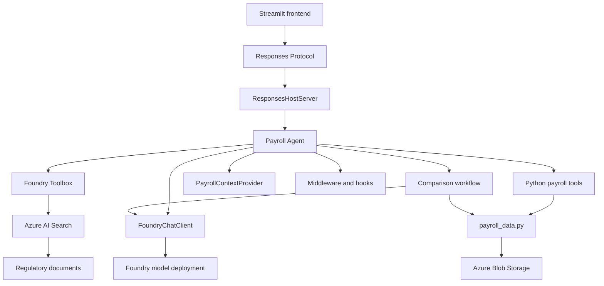
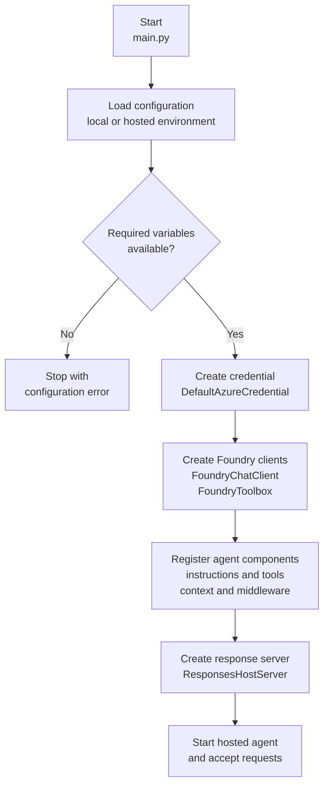

# Architecture diagrams

These diagrams provide a visual overview of the main component dependencies and the hosted agent initialization process.

## Component dependencies

The payroll agent combines Microsoft Foundry services, local Python tools, structured payroll data and regulatory document retrieval.

### Component responsibilities

- `main.py` assembles and starts the hosted payroll agent.
- `FoundryChatClient` connects the agent to the configured model deployment.
- `FoundryToolbox` exposes the `payroll_search` retrieval tool.
- Python tools perform deterministic calculations and validations.
- `payroll_data.py` provides shared access to payroll CSV files.
- Middleware, hooks and the context provider add execution controls and conversational context.
- Streamlit communicates with the hosted agent through the Responses Protocol.

## Agent initialization flow

The hosted agent is initialized when the container starts `main.py`.

### Initialization result

After initialization, the server exposes the agent through the Responses Protocol. The agent can then select local payroll tools, execute the comparison workflow or retrieve regulatory documents through Azure AI Search.
